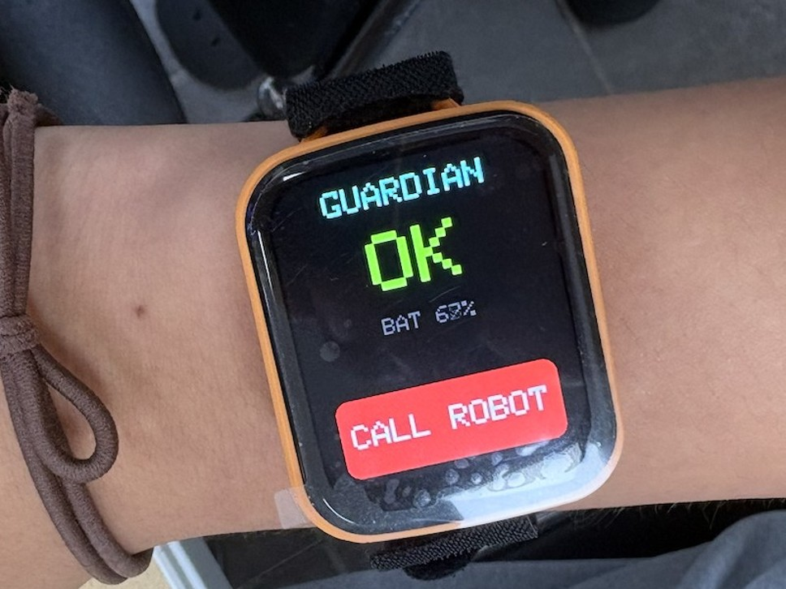

# GUARDIAN — Elderly Fall-Rescue Robot System

> **"Alerts are not enough. We RUN to you."**

Entry for the **Entrepreneurial Challenge** at the RoboRAVE 2026 World Championship in Osaka.
GUARDIAN is a two-part system: a wristwatch that detects falls by itself, and a rescue robot
that follows a floor line to the elderly person's side, hands out medicine, and calls for help —
all without internet or Wi-Fi.

**Team RoboMakers (KOREA)** — Seo-jun KIM · Tae-yang JANG · Seung-hun LEE · Seo-eun KIM



## System Architecture

```
[Watch: ESP32-S3]  --ESP-NOW (no internet)-->  [Gateway: LMS-ESP32]  --PUPRemote-->  [SPIKE Prime Hub]
 auto fall detection                            OLED status display                    3-wheel omni drive
 touch CALL button                              8-ch line sensor (Qwiic)               PID line following
 10s cancel window                              offline voice AI (KO/EN/JA)            ultrasonic stop
                                                medicine dispenser servo               T-junction docking
                                                backup smartphone web app
```

Key features: 3-stage + gyro fall detection, internet-free radio link (ESP-NOW unicast with
ACK-based retransmission), offline voice commands in Korean/English/Japanese with auto-wake
on robot arrival, and a smartphone backup web app (`http://192.168.4.1`) in case the watch fails.

## Repository Layout

| Folder | Contents |
|---|---|
| `firmware-watch/` | Watch firmware (Arduino, Waveshare ESP32-S3-Touch-LCD-1.69) |
| `gateway-lms-esp32/` | Gateway MicroPython (save as `main.py`) + drivers + debug tools |
| `robot-hub-pybricks/` | SPIKE Prime hub program (Pybricks) |
| `demo-mat/` | 1000×600mm demo mat artwork, print files, and generator script |
| `business-docs/en`, `ko` | Entrepreneurial Challenge deliverables (BMC, flyer, pitch script, BOM & pricing, Q&A, storyboard) |
| `presentation-scripts/` | Booth demo drama script (KO/EN) and full presentation scripts |
| `assets/` | Logos and prototype photos |
| `docs/` | System design document |
| `tools/` | Document generator scripts (docx-js / pptxgenjs / openpyxl) |

## Quick Start

1. **Watch** — flash `firmware-watch/watch_guardian_lcd.ino` with Arduino IDE
   (board: ESP32S3 Dev Module, USB CDC On Boot: Enabled, library: "GFX Library for Arduino").
   On battery: press PWR 1–2 s to boot, hold 3 s to power off.
2. **Gateway** — upload the files in `gateway-lms-esp32/` to the LMS-ESP32 with Thonny
   (keep the name `main.py`). Wiring: OLED SDA13/SCL14, SEN0539 on 26/27,
   line sensor on Qwiic, servo on GPIO21, external 5 V power bank.
3. **Robot** — upload both files in `robot-hub-pybricks/` via [Pybricks Code](https://code.pybricks.com).
   Motors A (45°) / C (180°) / E (−45°), ultrasonic on B, gateway on port D.
4. **Mat** — print `demo-mat/demo_mat_1000x600_print.pdf` at actual size, lay black electrical
   tape over the printed line (printer ink is often invisible to IR sensors), then calibrate
   with `gateway-lms-esp32/debug-tools/debug_line_pet.py`.

## Voice Commands (SEN0539, self-learned)

| ID | Phrase | Action |
|---|---|---|
| 5 · 6 · 7 | "약 주세요" / "Medicine please" / "くすりください" | dispense medicine (servo) |
| 8 · 9 · 10 | "도와줘" / "Help me" / "たすけて" | siren + CALLING FAMILY display |

The module auto-wakes when the robot arrives — no wake word needed. Voice is ignored while
the robot is driving.

## Business Summary

Prototype cost $557 (competition limit $3,000) · production cost $117 per set at 10k units ·
retail $299 (60.9% margin) · B2G $249 · subscription $4/month. Full numbers and formulas in
`business-docs/` (BOM & Pricing spreadsheet, Business Model Canvas).

## License

Built by elementary and middle school students for RoboRAVE 2026.
Feel free to learn from this project; please credit Team RoboMakers.
