# Development Journal — How GUARDIAN Was Born

This folder documents our ideation process in the students' own handwriting and photos.
It shows something we are proud of: **we did not start with GUARDIAN. We got there by
brainstorming, role-playing, and pivoting** — the way real startups do.

## Week 1 (Jul 13) — Brainstorming: the pest-control robot

We started with a mind map of everyday problems: pests, trash, earthquakes, lost items,
helping the weak. The first vote picked a **pest-control robot** ("catches bugs for people
who are scared of them, and boils them in a pot").

| | |
|---|---|
| 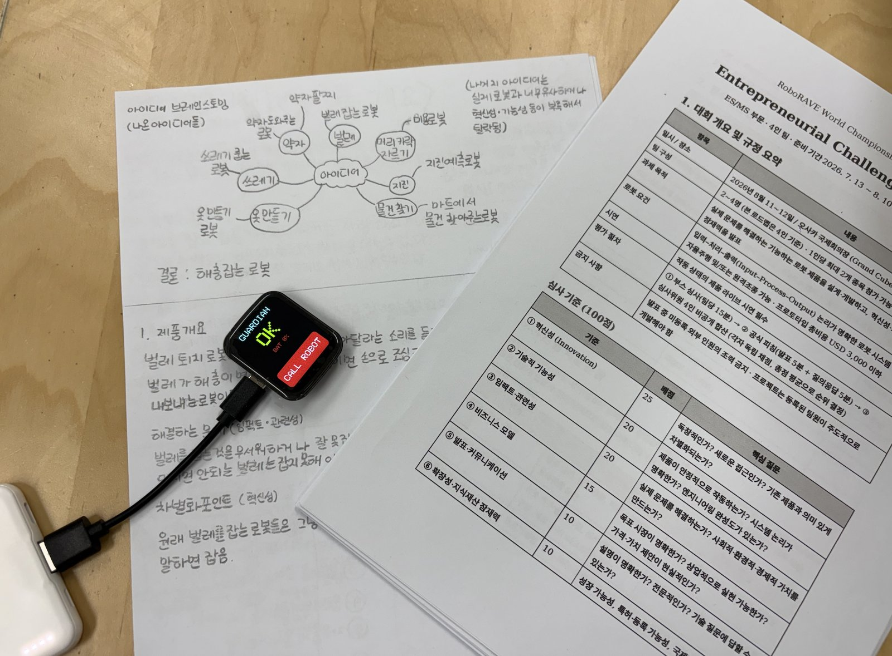 | 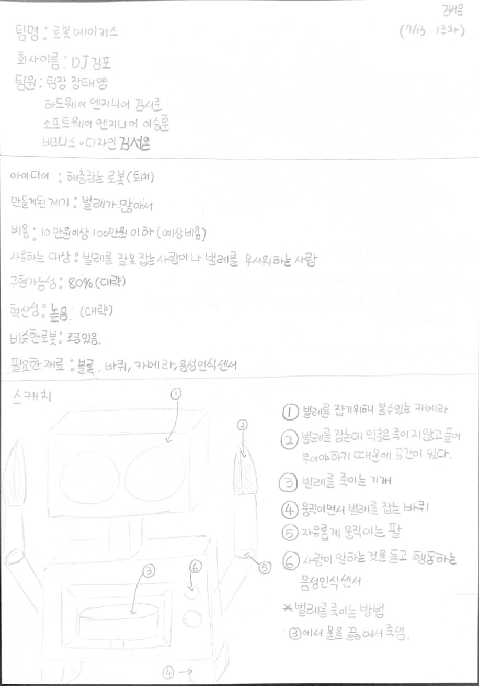 |
| Idea mind map + competition rules on the table | Week-1 idea sheet: pest-control robot |

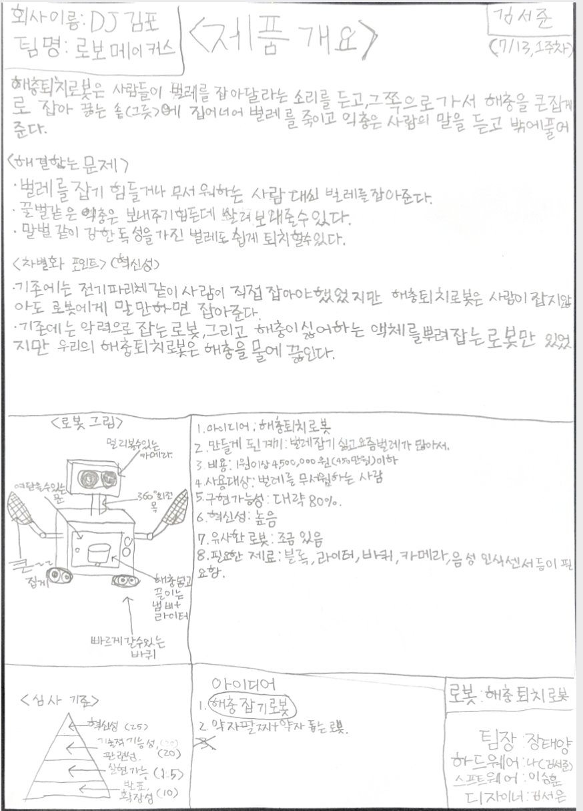
*Week-1 product overview by Seo-jun — problem, differentiation, materials, and the judging
criteria pyramid (Innovation 25 / Technical 20 / Impact 20 / Business 15 / Presentation 10 / IP 10).*

## The turning point — a role-play about grandma

While preparing a skit, Tae-yang drew a storyboard about a grandmother who fell and could
not reach her daily medicine. Acting it out, the whole team felt this problem was **real,
urgent, and ours** — several of us have grandparents living alone.

| | |
|---|---|
| 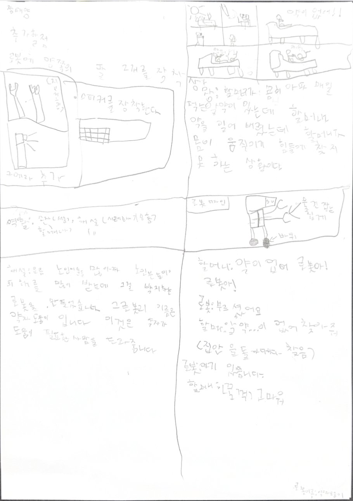 | 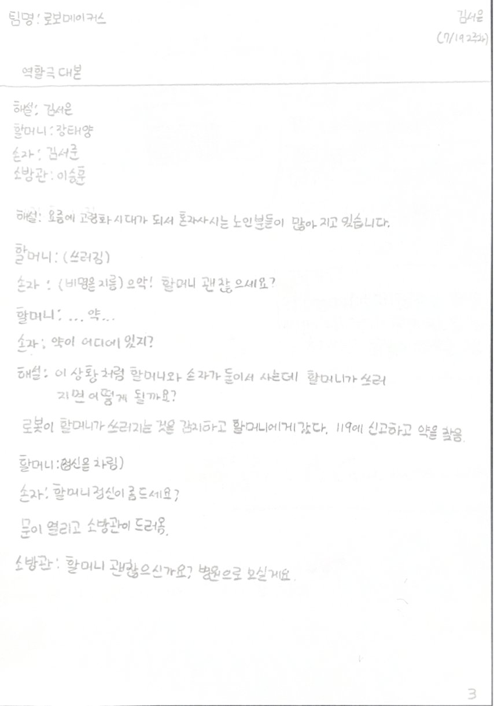 |
| Tae-yang's storyboard: "Grandma, there's no medicine!" | Week-2 role-play script (grandma · grandson · firefighter · narrator) |

## Week 2 (Jul 19) — The pivot: helper robot for the vulnerable

We compared the two ideas against the judging criteria and pivoted. The pest robot was fun,
but the helper robot scored higher on **impact and innovation** — and it mattered to us.
The week-2 sheets already contain the seeds of the final product: a gripper arm to bring
medicine, a camera to find grandma, a speaker to talk, a watch that calls 119.

| | |
|---|---|
| 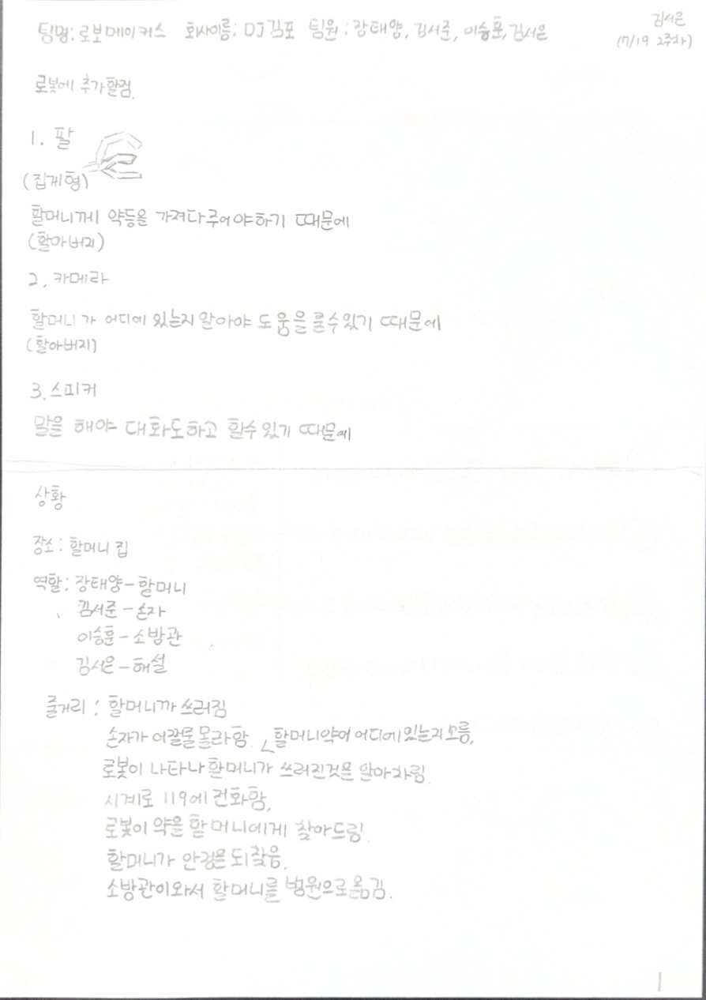 | 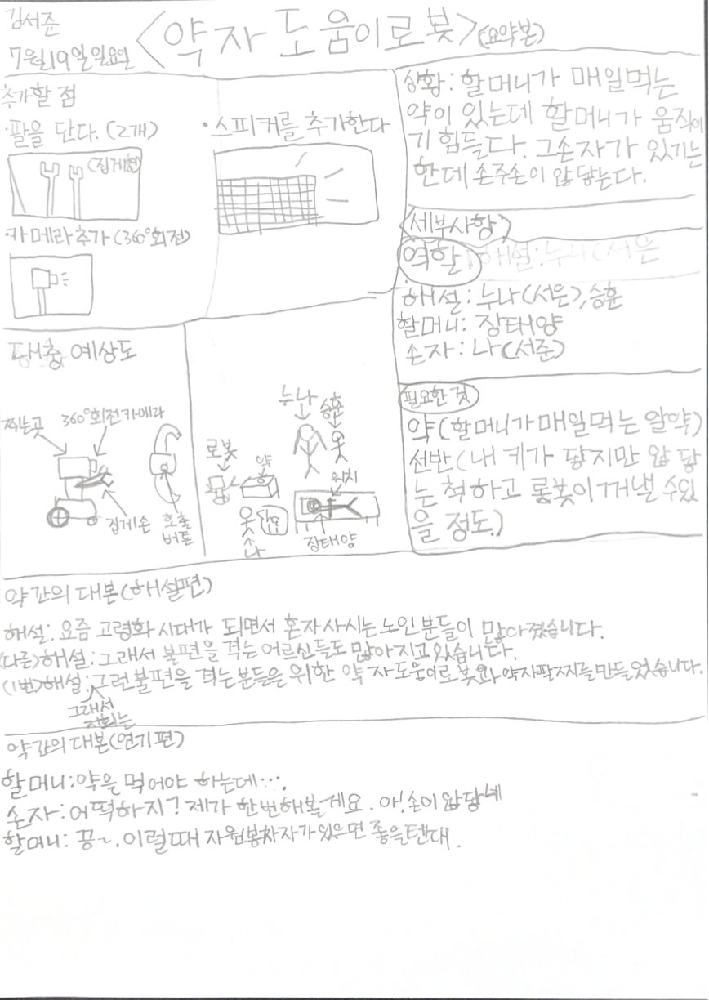 |
| Week-2 additions: arm, camera, speaker + skit scenario | Seo-jun's "Helper Robot" summary — the pest robot is crossed out |

## From sketches to a working system

| | |
|---|---|
| 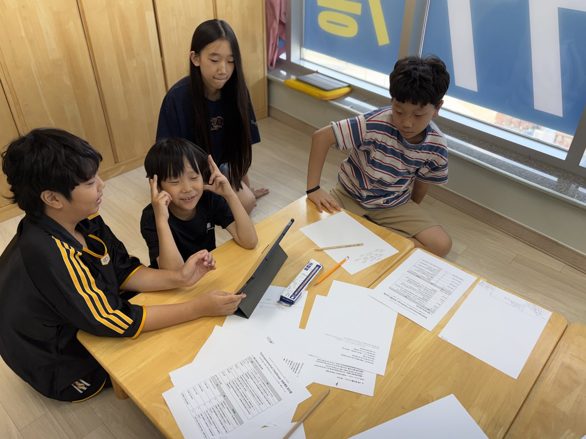 | 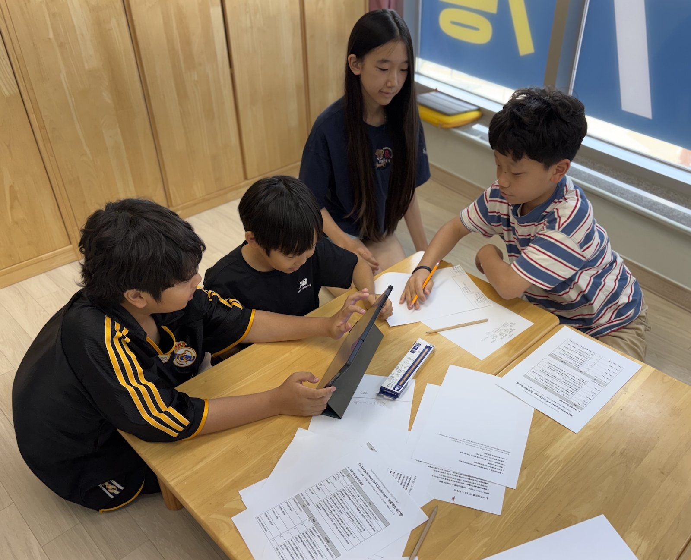 |
| 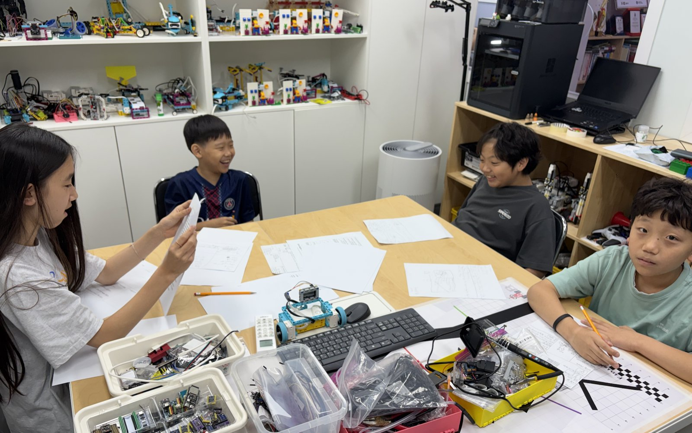 | 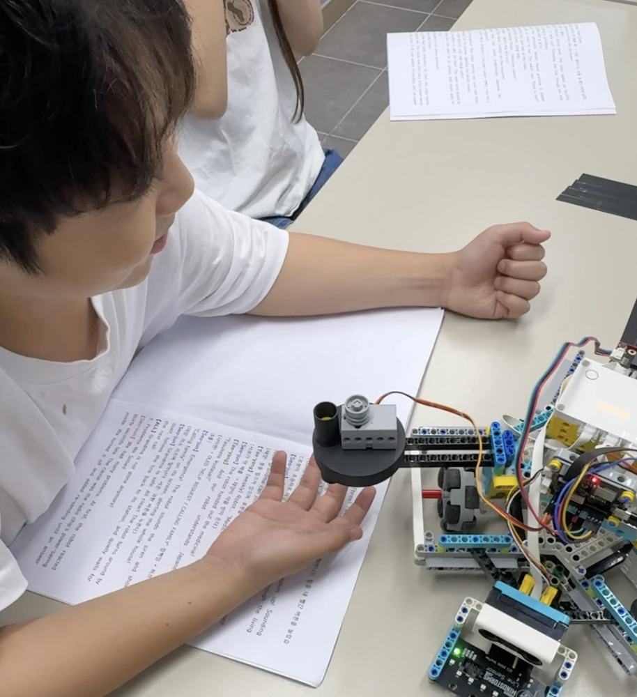 |

*Bottom right: the moment the ideas became real — the robot handing medicine to a user
during a demo rehearsal.*

The full technical result of this journey is in the rest of this repository: the watch
firmware, the gateway, the robot program, and the business documents.

> Demo videos will be added to this folder (or linked from YouTube) as we film them.
